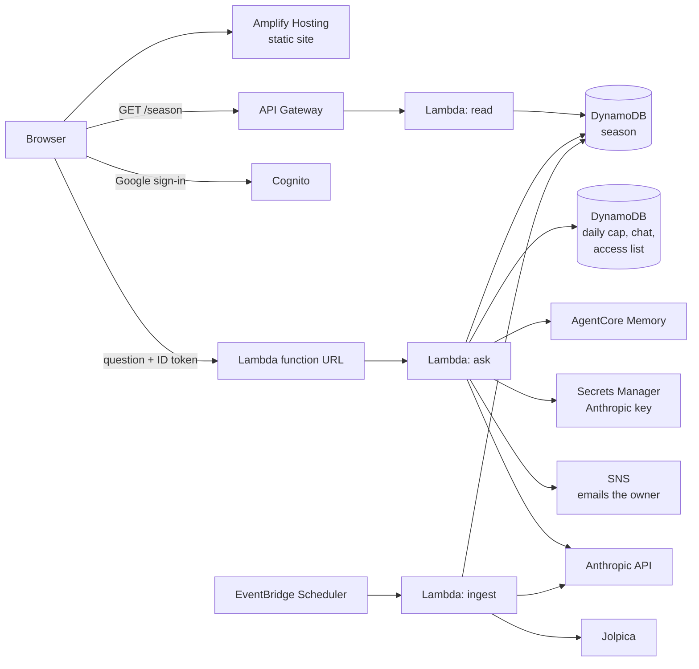

# Pit Wall

A one-page dashboard for the 2026 Formula 1 season, with a Claude strategist on the radio.

- **The board:** driver and team standings, the calendar (sprint weekends marked, start times in your time zone), and results.
- **Recaps:** a short AI-written recap of each race (sprints included) and of each qualifying session, generated from the stored results only.
- **Ask Pit Wall:** signed-in, approved visitors can ask questions. Claude answers from the stored season, can search the web and open pages when the board is not enough, and remembers a person's name, favourite driver and past chats between visits.
- **Invite-only chat:** anyone can read the board. Anyone can sign in with Google, but chat needs approval. A request emails the site owner, who approves or denies it in an admin panel on the site.

This is a proof of concept built on a free-plan AWS account. Data comes from [Jolpica](https://api.jolpi.ca/) (an Ergast-compatible F1 API); the page never calls it directly.

## Architecture



1. **Refresh.** A scheduled Lambda (`f1board/ingest_handler.py`) pulls standings, schedule, race, sprint and qualifying data from Jolpica and writes the season to DynamoDB in one transaction. A failed fetch writes nothing. It runs Monday morning and again on Saturday and Sunday evenings, so qualifying and race recaps appear the same weekend.
2. **Recaps.** After a refresh, `f1board/recap.py` makes at most one race recap (newest round with results) and one qualifying recap (a round whose qualifying is in but whose race is not). Each is written only when new, from the stored results alone, and a failure never fails the refresh.
3. **Reading.** `GET /season` (`f1board/read_handler.py`) returns the stored season as JSON. The static page in `web/` fetches it and draws it. A past race with no stored results shows "Results pending" instead of "Ran".
4. **Asking.** The page signs the visitor in with Google through Cognito (PKCE) and sends the ID token to a Lambda function URL (`f1board/ask_handler.py`). The Lambda checks the token, checks the visitor is approved, counts the question against a daily limit, builds a prompt from the stored season (plus a web lookup for results and news), and calls Claude. A question is charged before the model call and handed back if the season is incomplete.
5. **Memory.** `f1board/memory.py` retrieves what AgentCore Memory holds for the signed-in person (facts, preferences, session summaries) before the question, and records the exchange after the answer. It is scoped to the Cognito subject and never blocks an answer if it fails.
6. **Access.** `f1board/access.py` keeps one item per requesting email in the cap table. Fixed lists in the environment (`ALLOWED_EMAILS`, `ADMIN_EMAILS`) always win. With neither set the chat is open.

## Repository layout

| Path | What it is |
| --- | --- |
| `f1board/` | The Lambda code: ingest, read, ask, recaps, memory, access, parsing |
| `web/` | The static page (`render.js` and `ask.js` are plain browser scripts that also export for Node tests) |
| `tests/` | Python tests |
| `scripts/ship.sh` | Builds and deploys the Lambdas and the site |
| `scripts/deploy.sh` | One-time resource creation (create-only; it fails if resources already exist) |
| `requirements/` | Pinned Lambda dependencies (`ask.txt`, `ingest.txt`); Dependabot proposes bumps |
| `scripts/amplify-headers.template.yml` | Content-Security-Policy and other headers for Amplify |

## Run the tests

```
pip install -r requirements-dev.txt boto3 anthropic
python3 -m pytest -q
node --test web/*.test.js
```

Pass the glob to `node --test`; passing the directory reports a false failure.

## Preview the page locally

```
cd web && python3 -m http.server 8000
```

`web/config.js` ships with placeholder URLs. Point `SEASON_API` at a deployed season endpoint to see real data. Ask and sign-in also need `ASK_API`, `COGNITO_DOMAIN` and `COGNITO_CLIENT_ID`.

## Configuration

The ask Lambda reads these environment variables.

| Variable | Purpose |
| --- | --- |
| `TABLE_NAME`, `SEASON` | The season table and the year |
| `CAP_TABLE`, `DAILY_LIMIT` | Table for the daily count, chat history and access list; questions per person per day (default 30) |
| `COGNITO_ISSUER`, `COGNITO_CLIENT_ID` | Used to verify the Google sign-in ID token |
| `ANTHROPIC_SECRET_ID` | Secrets Manager secret holding the Anthropic API key |
| `CLAUDE_MODEL` | Model id (default `claude-sonnet-5-5`) |
| `AGENTCORE_MEMORY_ID` | AgentCore Memory resource; memory is off if unset |
| `ALLOWED_EMAILS` | Comma-separated verified emails that may always chat |
| `ADMIN_EMAILS` | Comma-separated verified emails that may approve or deny requests |
| `ACCESS_TOPIC_ARN`, `SITE_URL` | SNS topic that emails the owner about new requests; link used in that email |

The ingest Lambda needs `TABLE_NAME`, `SEASON`, `JOLPICA_BASE` and, for recaps, `ANTHROPIC_SECRET_ID`.

## Deploy

1. Create the resources once with `scripts/deploy.sh` (it needs `AWS_PROFILE` and `EXPECTED_ACCOUNT` set, and it does not create the ask Lambda, its function URL, the Cognito setup, the secret, the memory resource or the SNS topic).
2. Copy `scripts/ship.local.env.example` to `scripts/ship.local.env` and fill it in. That file is git-ignored.
3. Ship changes:

```
scripts/ship.sh ask|ingest|read|site|all [--dry-run] [--skip-tests]
```

`ship.sh` runs the tests, rebuilds each Lambda package from this repo plus the pinned dependencies in `requirements/` (built for Lambda: Linux x86_64, Python 3.12), and deploys. The site deploy keeps the **live** `config.js`, because the one in the repo only has placeholders. `--dry-run` builds everything and changes nothing.

4. Apply the security headers from `scripts/amplify-headers.template.yml` (fill in your hosts) with `aws amplify update-app --custom-headers`, then redeploy the site.

## Security notes

- The ask function URL has no AWS-level auth. All auth is in code: the Cognito ID token is verified (RS256, issuer, audience, token use; oversized or malformed tokens and unknown key ids are rejected without re-downloading keys) and the person must be approved. Restrict the function URL's CORS to your site's origin.
- Chat access is limited by email allow-list and admin approval; each approved person is limited to a daily number of questions. Set a monthly spend limit on your Anthropic account as a backstop.
- Access requests are capped (25 pending), one request per verified email, and the owner gets at most one notification email per 15 minutes.
- A question is handed back only when something other than the model failed. A model refusal or an empty answer still counts.
- The site sends a strict Content-Security-Policy. Answers are rendered with an escaping-first Markdown renderer that only allows https links and shows each link's real host.
- Server-side URL fetching blocks non-https, non-443, private, loopback and link-local addresses and re-checks redirects.
- Memory is scoped to the signed-in person. Text a visitor or a web page puts in a chat can end up in that person's own memory.
- Dependencies are pinned in `requirements/`.

## Data retention

Enable DynamoDB TTL on the cap table with the attribute `expiresAt`. Daily counts expire after 3 days, chat history after 30 days, and pending or denied access requests after 90 days; approved entries are kept. AgentCore Memory keeps raw events for 30 days, but the long-term records it extracts stay until deleted.

## Costs and limits

Built to run on the AWS Free Tier (Lambda, DynamoDB, API Gateway, Amplify, Cognito, EventBridge, SNS) plus Secrets Manager, AgentCore Memory and the Anthropic API, which bill by use. Not every AWS service is available on every plan; check yours.

## Not covered

Practice sessions are not summarised.

## License

[MIT](LICENSE).
